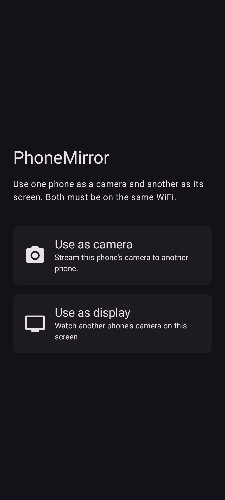
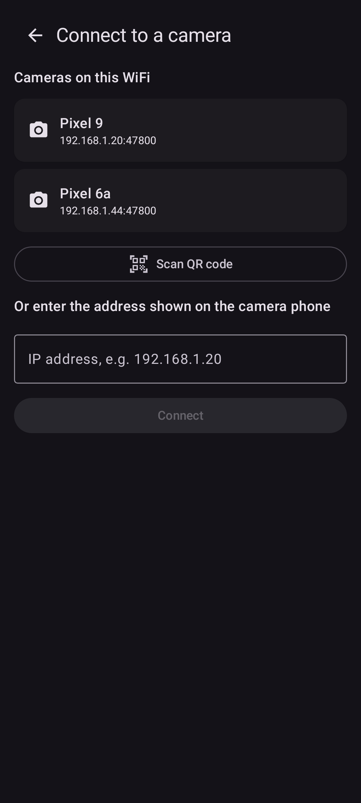
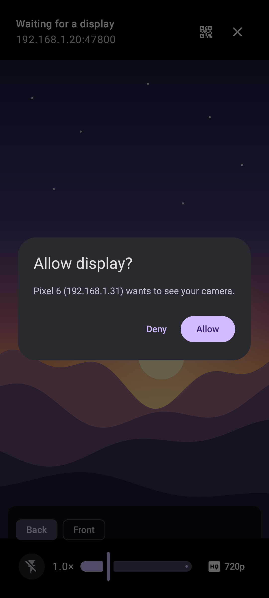
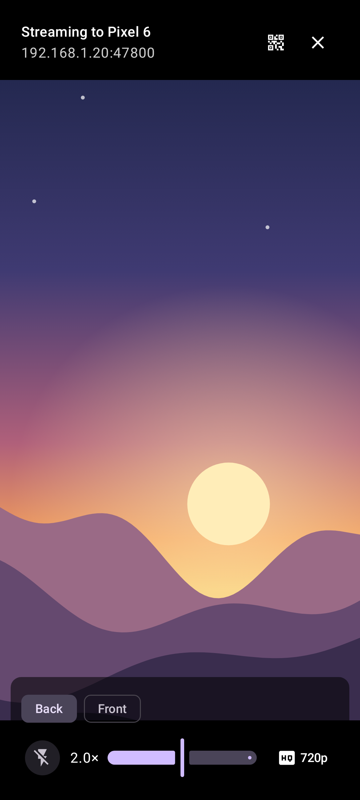
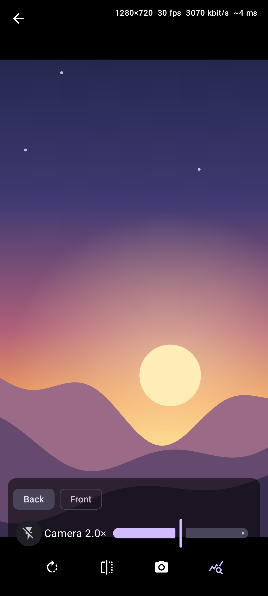
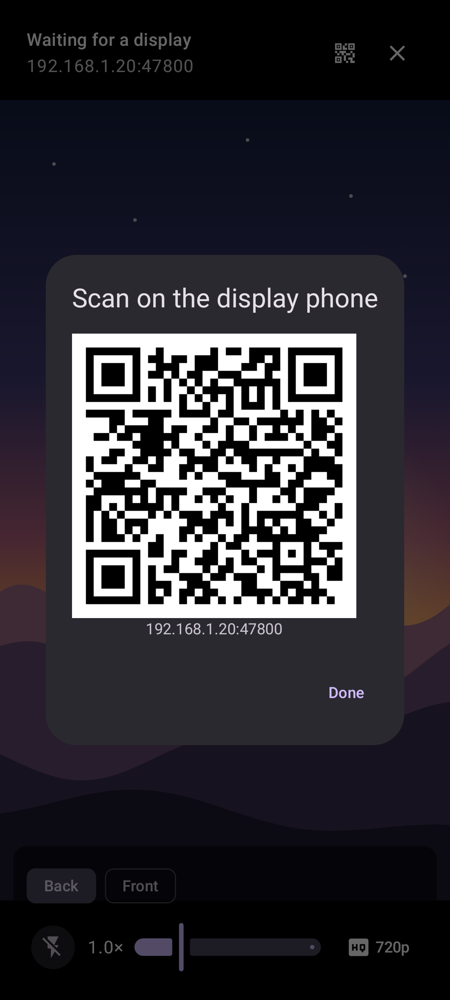

# PhoneMirror

Turn one Android phone into a live camera and another into its remote display over local WiFi — no server.

- **Camera role:** pick a lens, toggle the torch, zoom; keeps streaming in the background (foreground service).
- **Display role:** finds cameras via mDNS, manual IP or QR code; pinch-zoom/pan, rotate/mirror, snapshot, stats overlay; can drive the camera's lens, torch and zoom remotely.
- **Transport:** hardware H.264 over a single TCP connection (port 47800), one viewer at a time, the camera phone approves every viewer.

Download the APK from the [latest release](https://github.com/filiprojek/phone-mirror/releases/latest).

## Screenshots

| Pick a role | Find the camera | Approve the display |
|:---:|:---:|:---:|
|  |  |  |
| **Camera phone** | **Display phone** | **Connect by QR code** |
|  |  |  |

<sub>Rendered from the app's Compose UI with sample data (`scripts/screenshots.sh`); the camera picture is a drawn stand-in for real footage.</sub>

## Layout

| Module | What |
|---|---|
| `core/` | Pure Kotlin/JVM: wire protocol, socket transport, session state machines, view/zoom math. Fast unit tests. |
| `app/`  | Android app: Camera2, MediaCodec, NSD, foreground service, Compose UI. |

## Build

Requires JDK 17+ and an Android SDK (`ANDROID_HOME`) with platform 37.

```sh
./gradlew :core:test :app:testDebugUnitTest   # unit tests
./gradlew :app:assembleDebug                   # APK in app/build/outputs/apk/debug/
./gradlew connectedDebugAndroidTest            # on-device tests (needs adb)
```

## Releasing

```sh
scripts/release.sh patch          # or minor, major, or an explicit X.Y.Z
scripts/release.sh minor --dry-run
```

From a clean `master` that matches `origin/master`, the script runs the unit tests, bumps
`VERSION_NAME` in `gradle.properties` (versionCode = major·10000 + minor·100 + patch), commits
`chore(release): vX.Y.Z`, tags `vX.Y.Z` and pushes. The tag starts the
[Release workflow](.github/workflows/release.yml), which builds the R8-shrunk APK, signs it and
publishes a GitHub Release with the APK, its SHA-256 and notes grouped from the Conventional
Commits since the previous tag (`scripts/release-notes.sh`). `scripts/tests/release_test.sh`
tests both scripts.

**Signing.** Release builds read `PM_KEYSTORE_FILE`, `PM_KEYSTORE_PASSWORD`, `PM_KEY_ALIAS` and
`PM_KEY_PASSWORD` from the environment, or from a gitignored `keystore.properties` with the same
keys for local builds. CI gets them from the repository secrets `PM_KEYSTORE_BASE64` (the keystore,
base64-encoded), `PM_KEYSTORE_PASSWORD`, `PM_KEY_ALIAS` and `PM_KEY_PASSWORD`. Keep a backup of the
keystore: without it, later versions cannot be installed over existing ones.

## Notes

- **Android 17 (API 37):** both roles need the runtime `ACCESS_LOCAL_NETWORK` permission for LAN sockets and NSD; the app requests it.
- **Approval:** every new display must be allowed on the camera phone (dialog, or a heads-up notification with Allow/Deny when the app is in the background; auto-deny after 30 s). The display that was last allowed may reconnect silently within 2 minutes of dropping, so WiFi blips do not need another tap.
- **Lenses:** phones with a logical multi-camera (e.g. Pixels) expose one back camera whose zoom range starts below 1× — the ultrawide is reached through zoom.

## Verified on hardware (Pixel 9 camera → Pixel 6 display, Android 17)

NSD discovery, approval dialog, 720p30 at ~3 Mbit/s with ~5 ms latency, remote torch / zoom / lens switch,
stats overlay, snapshot to the gallery, streaming with the camera app in the background, and automatic
reconnect after the display's WiFi was toggled.

## License

Copyright (C) 2026 Filip Rojek

This program is free software: you can redistribute it and/or modify it under the terms of the
GNU General Public License as published by the Free Software Foundation, either version 3 of the
License, or (at your option) any later version.

This program is distributed in the hope that it will be useful, but WITHOUT ANY WARRANTY; without
even the implied warranty of MERCHANTABILITY or FITNESS FOR A PARTICULAR PURPOSE. See the
[GNU General Public License](LICENSE) for more details.

SPDX-License-Identifier: `GPL-3.0-or-later`
